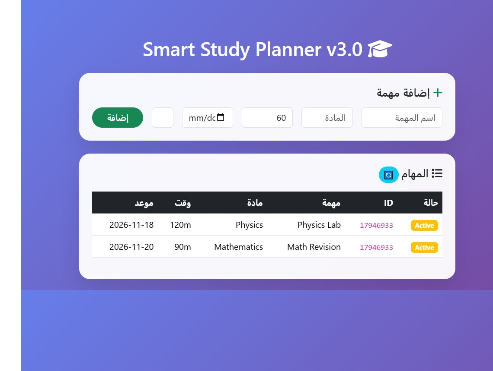

# Smart Study Planner

A study task manager in C++17 that runs its own small HTTP server. No framework: you start the exe, open `http://localhost:3000`, and get an Arabic web page that talks to the C++ process.

I wanted to see how much I could build with the standard library and raw sockets.



## How it works

- Tasks live in a linked list I wrote myself (`TaskNode`)
- A `std::priority_queue` with a custom comparator orders them by urgency
- The urgency score depends on days left and priority. Closer deadline or higher priority means a higher score. Finished tasks go last.
- The daily plan is a `std::deque` capped at 240 minutes
- The server uses Winsock sockets, one thread per client, so it is Windows only
- Data is saved to `study_planner.json`

## API

| Method | Path | |
|---|---|---|
| GET | `/api/tasks` | all active tasks |
| POST | `/api/tasks` | add a task |
| GET | `/health` | `{"status":"ok"}` |

```bash
curl -X POST http://localhost:3000/api/tasks \
  -H "Content-Type: application/json" \
  -d '{"name":"Math Revision","subject":"Mathematics","estimated_time":90,"deadline":"2026-11-20","priority":8}'
```

## Build

```bash
g++ -std=c++17 -O2 -static src/main.cpp -o planner.exe -lws2_32
./planner.exe
```

CMake and MSVC also work. Everything is in `src/main.cpp`.

Mahmoud Saleh
